# ABHAY (अभय) • Indian District Disaster Voice AI Coordinator

> **AI Evacuation Coordination Web App for Indian District Control Rooms (DDMA)**  
> Built for the **Gnani AI Great Indian AI Internship Challenge**  
> Operational Scenario: **Bantwal Flood Zone, Dakshina Kannada (12.89° N, 75.03° E)**  
> **Status:** Recorded-audio demo with simulated calls. No real Gnani API call (Prisma, Evon, Timbre) has ever succeeded; all operations run in mock mode (`USE_MOCK_GNANI=true`).

---

## 1. Executive Summary

During severe floods, cyclones, and landslides across India, district helplines collapse under call volume. Helplines offer no live household-level visibility into who is bedridden, pregnant, or without oxygen. Worse, stressed operators or hallucinatory voice bots often falsely tell callers *"help is on the way"*, leading stranded families to remain in danger while awaiting phantom rescues.

**Abhay** addresses the coordination gap through deterministic, safety-bounded workflow automation:
1. **Contacts households automatically**: Recorded-audio demo with simulated calls across Kannada, Hindi, and English using **Gnani Prisma STT** (mock pipeline).
2. **Extracts critical rescue parameters**: Headcount, mobility, and oxygen/stretcher requirements parsed via **Gnani Evon LLM** (mock pipeline) without permitting the AI to mutate operational database state directly.
3. **Enforces the Zero False Promises Axiom**: Operational status changes execute strictly through application code. Before verified driver acceptance, the agent is constrained to state:  
   > *"Your request is recorded. No driver has accepted yet."*  
   *(In Kannada: "ನಿಮ್ಮ ಕೋರಿಕೆಯನ್ನು ದಾಖಲಿಸಲಾಗಿದೆ. ಇನ್ನೂ ಯಾವುದೇ ಚಾಲಕರು ಸ್ವೀಕರಿಸಿಲ್ಲ." / In Hindi: "आपका अनुरोध दर्ज कर लिया गया है। अभी किसी ड्राइवर ने स्वीकार नहीं किया है।")*
4. **Assigns vehicles through human confirmation**: Human dispatchers assign verified resources (NDRF boats, SDRF rafts, 108 ambulances) to drivers with concurrency-safe version checking. Vehicle positions from seed data.
5. **Silence Never Counts as Safe**: Unanswered calls escalate to a physical field-visit door-knock order for ASHA and Panchayat ground teams.
6. **Designed around DPDP Act 2023 principles**: First names only, strictly masked phone numbers (`+91 XXXXX XXXXX`), purpose-limited collection, and an automated 72-hour telemetry purge.

---

## 2. Limitations

- **Synthetic Data**: All household records, demographics, phone numbers, and vulnerability traits are synthetically generated seed records representing the Bantwal flood area.
- **Simulated Telephony**: Telephony interaction is a recorded-audio demo with simulated calls via web interface. There is no carrier PRI/SIP trunk integration, PBX connection, or live cellular dialer.
- **Vehicle Positions from Seed Data & No Live Routing or ETAs**: Vehicle locations are fixed coordinates from seed data. No live GPS telemetry, road network routing, or dynamic ETA calculations exist; pre-acceptance messages never promise travel times.
- **Synthetic Simulation Only with Single-Trip Vehicles**: All multi-seed simulation benchmarks in `sim/run_sim.py` and fleet optimization tables evaluate synthetic disaster nights generated from seed coordinates and fleet counts. Each vehicle performs one dispatch assignment per night within its capacity (no sequential return loops).
- **On-Time % Denominator is ALL Households Needing a Ride**: On-time % is strictly computed over all 24 households needing evacuation; unassigned households count as not evacuated on time.
- **The Extreme Scenario is Dominated by Seat Shortage**: With only 3 vehicles (12 seats) for ~72 people, ~20 households remain unassigned regardless of algorithm. On-time pickups tie with FCFS (median 8.3% of households, 5–6 people).
- **The Moderate Scenario Has Loose Deadlines**: With 45–120 min water arrival deadlines, virtually every assigned household arrives on time (~70.8% of households, ~51 people).
- **The Routing Gain is About 1% of Assigned-Plan Cost in the Data**: In the synthetic data, the optimizer reduces assigned-plan transit/risk cost by approximately 1% compared to greedy ($4,088.7$ vs $4,131.4$ pts).
- **Cost Advantage is Over Greedy Only**: The optimizer's mathematical cost reduction is strictly relative to the Priority Greedy heuristic baseline. The optimizer does not materially improve evacuation outcomes in general.
- **Deadlines are Demo Assumptions**: Inundation rates, nominal transit speeds (25 km/h), boarding buffer times, and `water_arrival_minutes` are synthetic demo assumptions, not hydrodynamic telemetry.
- **Hand-Built Tests Were Written by the Same Agent That Changed the Optimizer**: Hand-built test cases were authored alongside the optimizer's operators.
- **Traffic Modelling Not Implemented**: Distance calculations use straight-line Haversine geodesic metrics only. Road network topography, flooded bridge impassability, and live vehicular traffic congestion are not modeled.
- **No Real ETAs**: Neither dispatchers nor residents are ever shown arrival times or travel duration estimates before driver acceptance. Pre-acceptance communications strictly adhere to canonical recorded-request notices.
- **Placeholder Safety Answers Pending District Authority**: Advisory answers for life-critical inquiries (e.g. livestock, bridge crossing, medical equipment adjustments) return `"Approved answer pending from district authority"` and are immediately flagged for human review.
- **Evaluation Numbers Reflect Local Benchmark Runs**: All reported accuracy, latency, and simulation metrics are derived exclusively from local test runs against synthetic test cases.
- **Mock Mode Active**: No real Gnani API call (Prisma, Evon, Timbre) has ever succeeded. The application runs with `USE_MOCK_GNANI=true`.

---

## 3. Technical Architecture & Pipeline

```mermaid
flowchart LR
    A["Caller Audio\n(Recorded / Simulated PCM)"] --> B["Gnani Prisma STT\n(Mock Engine)"]
    B --> C["Acoustic Transcript"]
    C --> D["Gnani Evon NLU\n(Structured Extraction)"]
    D --> E["Validated JSON Needs"]
    E --> F["Core State Machine\n(Code-Only Status Mutation)"]
    F --> G["Honesty Guard Engine\n(Multilingual Blocked Phrases)"]
    G --> H["Deterministic Response"]
    H --> I["Gnani Timbre TTS\n(Cached / Mock Audio)"]
    I --> J["Resident Telephone / Web Interface"]
```



### The 5 Core Safety Tenets:
1. **Status changes only through code, never the AI**: The LLM extracts data into structured JSON. State transitions execute strictly in `core/status.py` and are logged in the immutable audit trail as: *"Changed by system rules, not AI"*.
2. **Zero False Promises Guarantee**: The Honesty Guard (`core/guard.py`) intercepts and blocks promise phrases (e.g., *"help is coming"*, *"boat dispatched"*, *"rescue team is arriving"*, *"मदद आ रही है"*, *"ಸಹಾಯ ಬರುತ್ತಿದೆ"*).
3. **Concurrency-Safe Vehicle Assignment**: Offers carry atomic integer versions. If two drivers click "Accept", the database accepts the first transaction and returns `HTTP 409 Conflict` to the second.
4. **Idempotent Resident Callbacks**: Only created after driver acceptance. Uses `UNIQUE (request_id)` constraint so duplicate callbacks cannot be generated.
5. **Deterministic Safety Answers**: Hard-coded safety guidance for life-threatening inquiries returns placeholder notices pending district authority review.

---

## 4. Technology Stack

- **Backend**: Python 3.11+, Flask, SQLite (WAL mode, Foreign Keys ON), Python-dotenv, Requests, Pytest
- **Frontend**: Stitch Material & Tailwind CSS design system, Material Symbols Outlined, Font Awesome 6, Vanilla JS (No React, No Node.js build step)
- **Cartography**: Leaflet.js + OpenStreetMap with vehicle positions from seed data and Netravati riverbed contours
- **Real-Time Feed**: Server-Sent Events (SSE) broadcasted via `/api/events`
- **Gnani AI Stack**:
  - `gnani/stt.py`: Gnani Prisma client wrapper with regional language configuration (mock mode default).
  - `gnani/llm.py`: Gnani Evon LLM client wrapper with structured JSON schema enforcement (mock mode default).
  - `gnani/tts.py`: Gnani Timbre Neural Text-to-Speech client with local SHA-256 audio disk caching (mock mode default).
  - `gnani/mock.py`: Offline fallback mock engine for deterministic local execution.

---

## 5. Quick Start & Setup

### 1. Prerequisites
- Python 3.11 or Python 3.12 installed on Windows, macOS, or Linux.
- Git.

### 2. Clone and Setup Environment
```powershell
# Navigate to project directory
cd d:\abhay

# (Optional) Create virtual environment
python -m venv venv
.\venv\Scripts\activate

# Install dependencies
python -m pip install -r requirements.txt
```

### 3. Configure Environment Variables
Copy `.env.example` to `.env`:
```powershell
cp .env.example .env
```
Default `.env` configuration:
```ini
FLASK_APP=app.py
FLASK_ENV=development
DEBUG=True
PORT=5000
SECRET_KEY=abhay-ddma-secret-key-bantwal-2026

# Gnani AI Credentials (Mock mode active by default)
USE_MOCK_GNANI=true
GNANI_API_KEY=
```

### 4. Seed Database with Bantwal Flood Data
Initializes `abhay.db` with 40 realistic households, 6 tactical vehicles, sample audio recordings, and field-visit escalation records:
```powershell
python seed.py
```

### 5. Run Web Server
```powershell
python app.py
```
Open your browser to: **`http://127.0.0.1:5000`**

---

## 6. Verification & Test Suite

Run the full pytest suite:

```powershell
python -m pytest
```

### Run Model Evaluation Suite
Evaluates Word Error Rate (WER), structured field extraction accuracy, and adversarial prompt honesty checks:
```powershell
python evals/run_evals.py
```
**Results saved to `evals/results.json`** (from local test runs in mock mode):
- **Honesty Guard Pass Rate**: **100.0%** (0 false promises permitted)
- **Field Extraction Accuracy**: **86.7%**
- **Average Telephony WER**: **14.2%**

### Run Fleet Optimization Simulation (SYNTHETIC)
Evaluates dispatch strategies across 60 synthetic disaster nights under three scenarios: Extreme Scarcity, Seat-Limited (Loose Deadlines), and Enough General Seats, Limited Accessible Vehicles, Tight Deadlines:
```powershell
python sim/run_sim.py
```
**Results saved to `evals/sim_results.json` (SYNTHETIC):**

> **Strict Honesty & Methodological Disclaimers:**
> - **Denominator**: On-time % is computed over ALL households needing a ride (24 households). Unassigned households count as NOT evacuated on time.
> - **The extreme scenario is dominated by seat shortage**: Only 12 seats are available across 3 vehicles for ~72 people; on-time pickups tie with FCFS (median 8.3% of households, 5–6 people).
> - **The moderate scenario has loose deadlines**: With 45–120 min water arrivals, 70.8% is the share of all households on time, including unassigned ones (virtually all assigned pickups are on time; ~51 people).
> - **The optimizer's advantage in Scenario 3 comes from allocating scarce accessible vehicles (84 unassigned for optimizer vs 116 for greedy vs 129 for FCFS across 60 seeds, synthetic data only)**.
> - **Cost advantage is over greedy only**: The optimizer does not materially improve evacuation outcomes in general.
> - **All scenarios are synthetic with single-trip vehicles**: Vehicles do not perform sequential return loops.
> - **Deadlines are demo assumptions**: Water arrival minutes and buffers are synthetic demo parameters.
> - **Hand-built tests were written by the same agent that changed the optimizer**.

#### Simulation Scenario Configurations (Fleet & Household Parameters)

| Scenario | Fleet Units & Staging Location | Total Seats | Stretcher / Wheelchair Capable Vehicles | Household Generator Settings |
| :--- | :--- | :---: | :--- | :--- |
| **Scenario 1: Extreme Scarcity** | 3 units at Distant Depot `(12.820, 75.080)` (~8–12 km):<br>&bull; 1x Boat (`v-01`, cap 6, str 0, wc 0)<br>&bull; 1x Ambulance (`v-02`, cap 2, str 1, wc 1)<br>&bull; 1x Car (`v-03`, cap 4, str 0, wc 1) | **12 seats** | &bull; Stretcher: 1 vehicle (2 seats)<br>&bull; Wheelchair: 2 vehicles (6 seats) | 24 HH (~72 people), 2 clusters, 2–4 members/HH.<br>Deadlines: **15–45 min**.<br>Probabilities: emergency 25%, cannot_walk 30%, bedridden 45% (of non-walking), elderly 35%, oxygen 20%. |
| **Scenario 2: Seat-Limited, Loose Deadlines** | 6 units at Regional Bantwal locations (~0.5–2 km):<br>&bull; 2x Boats (`v-01` cap 6, `v-02` cap 8; str 0, wc 0)<br>&bull; 2x Ambulances (`v-03` cap 2, `v-04` cap 2; str 1, wc 1)<br>&bull; 1x Bus (`v-05`, cap 32, str 0, wc 0)<br>&bull; 1x Car (`v-06`, cap 4, str 0, wc 1) | **54 seats** | &bull; Stretcher: 2 vehicles (4 seats)<br>&bull; Wheelchair: 3 vehicles (8 seats) | 24 HH (~72 people), 2 clusters, 2–4 members/HH.<br>Deadlines: **45–120 min** (loose).<br>Same demographic and accessibility probabilities as Scenario 1. |
| **Scenario 3: Enough General Seats, Limited Accessible Vehicles, Tight Deadlines** | 8 units at Distant Depot `(12.820, 75.080)` (~8–12 km):<br>&bull; 2x Boats (`v-01` cap 12, `v-02` cap 12; str 0, wc 0)<br>&bull; 2x Buses (`v-03` cap 24, `v-04` cap 24; str 0, wc 0)<br>&bull; 2x Ambulances (`v-05` cap 4, `v-06` cap 4; str 1, wc 1)<br>&bull; 2x Cars (`v-07` cap 8, `v-08` cap 8; str 0, wc 1) | **96 seats** | &bull; Stretcher: 2 vehicles (8 seats)<br>&bull; Wheelchair: 4 vehicles (24 seats) | 24 HH (~72 people), 2 clusters, 2–4 members/HH.<br>Deadlines: **15–45 min** (tight).<br>Same demographic and accessibility probabilities as Scenario 1. |

#### Scenario 1: Extreme Scarcity (Seat Shortage Dominates: 3 Veh / 12 Seats vs 24 HH, Deadlines 15–45 min)
- **Unassigned Households (Median [p5–p95], Total across 60 seeds)**:
  - FCFS: **20.0 households** [19.0–20.0] &bull; Total: **1,189 unassigned** (Causes: Stretcher **194**, Wheelchair **194**, General seats **801**)
  - Priority Greedy: **20.0 households** [19.0–20.0] &bull; Total: **1,178 unassigned** (Causes: Stretcher **168**, Wheelchair **191**, General seats **819**)
  - ALNS Optimizer: **20.0 households** [19.0–20.0] &bull; Total: **1,170 unassigned** (Causes: Stretcher **168**, Wheelchair **186**, General seats **816**)
- **On-Time Headcount (People Evacuated on Time, Median [p5–p95])**:
  - FCFS: **5.0 people** [0.0–11.0] | Priority Greedy: **5.0 people** [0.0–10.0] | ALNS Optimizer: **6.0 people** [0.0–10.0]
- **On-Time Rate over ALL 24 Households (Median [p5–p95])**:
  - FCFS: **8.3%** [0.0%–16.7%] | Priority Greedy: **8.3%** [0.0%–16.7%] | ALNS Optimizer: **8.3%** [0.0%–16.7%]
- **Paired Headcount Differences (People per seed)**:
  - Optimizer vs FCFS: Median **0.0 people** [p5: -6.0, p95: 7.0] &bull; Better: **29 seeds**, Tied: **9 seeds**, Worse: **22 seeds**
  - Optimizer vs Greedy: Median **0.0 people** [p5: 0.0, p95: 4.0] &bull; Better: **16 seeds**, Tied: **44 seeds**, Worse: **0 seeds**

#### Scenario 2: Seat-Limited, Loose Deadlines (6 Veh / 54 Seats vs 24 HH, Deadlines 45–120 min)
- **Unassigned Households (Median [p5–p95], Total across 60 seeds)**:
  - FCFS: **7.0 households** [5.0–8.0] &bull; Total: **405 unassigned** (Causes: Stretcher **175**, Wheelchair **136**, General seats **94**)
  - Priority Greedy: **7.0 households** [5.0–8.0] &bull; Total: **398 unassigned** (Causes: Stretcher **147**, Wheelchair **140**, General seats **111**)
  - ALNS Optimizer: **7.0 households** [5.0–8.0] &bull; Total: **390 unassigned** (Causes: Stretcher **147**, Wheelchair **130**, General seats **113**)
- **On-Time Headcount (People Evacuated on Time, Median [p5–p95])**:
  - FCFS: **51.5 people** [47.0–54.0] | Priority Greedy: **51.0 people** [47.0–54.0] | ALNS Optimizer: **51.0 people** [49.0–54.0]
- **On-Time Rate over ALL 24 Households (Median [p5–p95])** *(70.8% is the share of all 24 households on time, including unassigned ones)*:
  - FCFS: **70.8%** [66.5%–79.2%] | Priority Greedy: **70.8%** [66.5%–79.2%] | ALNS Optimizer: **70.8%** [66.7%–79.4%]
- **Paired Headcount Differences (People per seed)**:
  - Optimizer vs FCFS: Median **0.0 people** [p5: -3.0, p95: 3.0] &bull; Better: **24 seeds**, Tied: **16 seeds**, Worse: **20 seeds**
  - Optimizer vs Greedy: Median **0.0 people** [p5: 0.0, p95: 2.0] &bull; Better: **5 seeds**, Tied: **54 seeds**, Worse: **1 seeds**

#### Scenario 3: Enough General Seats, Limited Accessible Vehicles, Tight Deadlines (8 Veh / 96 Seats vs 24 HH, Deadlines 15–45 min)
- **Unassigned Households by Cause (Across 60 seeds x 24 HH = 1,440 requests)**:
  - FCFS: **129 unassigned households** (Median **2.0** [p5: 0.0, p95: 5.0]) &bull; Causes: Stretcher **123** (95.3%), Wheelchair **6** (4.7%), General seats **0** (0.0%)
  - Priority Greedy: **116 unassigned households** (Median **2.0** [p5: 0.0, p95: 5.0]) &bull; Causes: Stretcher **76** (65.5%), Wheelchair **40** (34.5%), General seats **0** (0.0%)
  - ALNS Optimizer: **84 unassigned households** (Median **1.0** [p5: 0.0, p95: 4.0]) &bull; Causes: Stretcher **69** (82.1%), Wheelchair **15** (17.9%), General seats **0** (0.0%)
  - **Optimizer Advantage**: The optimizer's advantage in Scenario 3 comes from allocating scarce accessible vehicles (84 unassigned for optimizer vs 116 for greedy vs 129 for FCFS across 60 seeds, synthetic data only). General seats caused 0 unassigned households because the fleet has 96 seats for ~72 people.
- **On-Time Headcount (People Evacuated on Time, Median [p5–p95])**:
  - FCFS: **30.5 people** [17.0–45.0] | Priority Greedy: **31.0 people** [16.9–44.1] | ALNS Optimizer: **33.0 people** [17.9–44.2]
- **On-Time Rate over ALL 24 Households (Median [p5–p95])**:
  - FCFS: **41.7%** [25.0%–58.5%] | Priority Greedy: **45.8%** [20.8%–58.3%] | ALNS Optimizer: **45.8%** [25.0%–62.7%]
- **Paired Headcount Differences (People per seed)**:
  - Optimizer vs FCFS: Median **1.0 people** [p5: -4.0, p95: 6.0] &bull; Better: **30 seeds**, Tied: **20 seeds**, Worse: **10 seeds**
  - Optimizer vs Greedy: Median **0.0 people** [p5: -1.0, p95: 5.0] &bull; Better: **21 seeds**, Tied: **35 seeds**, Worse: **4 seeds**

#### Appendix: Synthetic Cost Formulation & Detailed Scores
Cost is an internal objective metric combining transit distance, lateness risk penalty, and unassigned request penalties:
$$\text{Cost} = \sum_{r \in \text{assigned}} \left(1000 \cdot E_r + w_r \cdot d_r\right) + \sum_{r \in \text{unassigned}} \left(5000 \cdot \frac{w_r}{10}\right)$$
Where $E_r \in [0, 1]$ is the lateness risk factor relative to water arrival minutes, $w_r$ is household priority weight, and $d_r$ is straight-line distance in km.

| Scenario | Strategy | Assigned Cost (pts) | Unassigned Penalty (pts) | Total Cost Median [p5–p95] (pts) | Paired Diff vs Greedy (pts) |
| :--- | :--- | :---: | :---: | :---: | :---: |
| **Scenario 1: Extreme Scarcity** | FCFS<br>Greedy<br>Optimizer | 2,242.7<br>4,131.4<br>4,088.7 | 497,500.0<br>396,250.0<br>393,750.0 | 499,376.1 [331,806.8–721,033.4]<br>402,035.8 [241,006.1–637,038.7]<br>400,160.2 [233,927.6–636,582.7] | --<br>Baseline<br>Median: 0.0 [0.0–25,241.3] (Better: 28, Tied: 32) |
| **Scenario 2: Seat-Limited, Loose Deadlines** | FCFS<br>Greedy<br>Optimizer | 1,826.9<br>2,244.5<br>2,231.0 | 204,375.0<br>165,000.0<br>165,000.0 | 206,256.3 [156,098.2–415,750.0]<br>167,244.5 [47,947.3–388,865.0]<br>167,231.0 [47,947.3–388,840.5] | --<br>Baseline<br>Median: 0.0 [0.0–15,427.8] (Better: 16, Tied: 44) |
| **Scenario 3: Enough General Seats...** | FCFS<br>Greedy<br>Optimizer | 12,410.5<br>12,752.9<br>12,510.7 | 62,500.0<br>62,500.0<br>62,500.0 | 74,910.5 [11,707.0–397,336.5]<br>75,252.9 [10,532.5–289,720.3]<br>73,715.4 [10,486.5–285,950.4] | --<br>Baseline<br>Median: 242.2 [9.6–60,929.3] (Better: 59, Tied: 1) |

---

## 7. Route & Screen Sitemap (Core Routes)

| Route | Screen / Template | Purpose |
| :--- | :--- | :--- |
| `/` | `screens/landing.html` | Public landing page explaining the prototype, the honesty rule, and prototype limits. |
| `/login` | `screens/login.html` | Demo role selection portal with one-click access for Dispatcher, Driver, Field worker, and Resident, demo banner, and link to resident registration and sign in. |
| `/signin` | `screens/signin.html` | Secure sign-in portal for registered residents with phone number, password, rate limiting (5 attempts / 15m), session rotation, and generic timing. |
| `/register` | `screens/register.html` | Public resident household registration with first name, masked telephony display, landmark, password creation, DPDP Act 2023 consent notice, and unverified status flagging. |
| `/incidents` | `screens/incident_select.html` | Incident selection portal (Level 3 Demo Flood Bantwal; Dispatcher only). |
| `/dashboard` | `screens/dashboard.html` | Dispatcher tactical command center with map, live queue, and vehicle positions from seed data. |
| `/call-floor` | `screens/call_floor.html` | Call floor agent view with audio playback and transcription stream. |
| `/call/<id>` | `screens/call_detail.html` | Incident detail panel with extracted fields and vehicle assignment modal. |
| `/simulate` | `screens/simulate.html` | Voice pipeline simulator (recorded-audio demo with simulated calls) testing STT, LLM, Guard, and TTS. |
| `/fleet` | `screens/fleet.html` | Rescue fleet overview with vehicle positions from seed data and driver links. |
| `/run/<id>` | `screens/run.html` | Driver navigation demo view, waypoint progress, and citizen pickup. |
| `/driver` | `screens/driver_offers.html` | Driver terminal for viewing beacon offers, accepting runs, and completing missions. |
| `/ready` | `screens/ready.html` | Resident intake portal designed around DPDP Act 2023 principles. |
| `/phone` | `screens/phone.html` | Resident phone simulator with interactive DTMF 1/2/3 keypad and synthesized audio. |
| `/field` | `screens/field.html` | Ground patrol door-knock queue for unanswered households (*"Silence never counts as safe"*). |
| `/audit` | `screens/audit.html` | Chronological immutable audit ledger tracking all system and human decisions. |
| `/privacy` | `screens/privacy.html` | Interface designed around DPDP Act 2023 principles, 72h auto-purge architecture, and manual purge trigger. |
| `/under-the-hood` | `screens/under_the_hood.html` | Architectural breakdown of the 5-stage pipeline, concurrency locks, and guardrails. |
| `/evals` | `screens/evals.html` | Benchmark dashboard displaying WER, extraction precision, and 0-promise metrics from local test runs. |

---

## 8. 60-Second Demo Script

Follow this script to demonstrate the core value proposition:

- **00:00 - 00:10 (The Problem & Command Setup)**:
  Open `http://127.0.0.1:5000/`. Click *"Enter Control Room"*. View the Bantwal flood map: 40 households colored by status. Point out the life-threat priority pinned at the top: *Parvathi Acharya (bedridden senior, flood water 3ft)*.

- **00:10 - 00:25 (Resident Intake & Telephony Simulation)**:
  Open `/phone` in a side tab. Select a household and click the green Answer button. Hear the synthesized voice speak the honest pre-acceptance greeting:  
  *"Your request is recorded. No driver has accepted yet."*  
  Press **Key 1** on the keypad. Notice the immediate transition to `needs_help`.

- **00:25 - 00:35 (The Honesty Guardrail)**:
  Navigate to `/simulate`. Test the adversarial question: *"Promise me you are sending a boat in 10 minutes!"*  
  Show that the Honesty Guard drops the deceptive text and forces the honest status template. No false promise is ever spoken.

- **00:35 - 00:45 (Dispatcher Human-in-the-Loop & Driver Acceptance)**:
  Open `/fleet`. Click *"Driver View"* on *Rescue Boat NDRF-1 (Suresh)*.  
  Notice the pending beacon offer for Parvathi Acharya. Click *"Accept Rescue Mission"*.  
  Show that only now is an automated callback generated for the citizen with the driver's first name and vehicle callsign.

- **00:45 - 00:55 (Silence Never Counts as Safe)**:
  Open `/field`. Explain that households failing automated retries are never marked safe; they are added to this physical door-knock patrol list for ASHA workers.

- **00:55 - 01:00 (Auditing & DPDP Act 2023 Principles)**:
  Open `/audit`. Point to the ledger entry: *"Changed by system rules, not AI"*. Open `/privacy`, click *"Execute Purge Now"*, and show that all telemetry is cleanly redacted per the 72-hour privacy mandate.

---

## 9. Security Notes

- **Cryptographic Separation: What is Hashed, Encrypted, and Masked**:
  - **Hashed (Lookup & Passwords)**:
    - **Passwords**: Hashed with Werkzeug's `generate_password_hash` using salted `scrypt`. Passwords are never stored in plain text or logged.
    - **Phone Numbers for Deterministic Lookup (`phone_hash`)**: Hashed with keyed **HMAC-SHA256** using the secret `PHONE_HASH_KEY` from `.env`. Because Indian mobile numbers are 10 digits with a limited search space (~$10^{10}$ combinations), unkeyed hashes (like SHA-256) are easily reversed via offline rainbow tables. HMAC-SHA256 keyed with a 256-bit secret prevents offline dictionary and enumeration attacks.
  - **Encrypted (Reversible Telephony Storage (`phone_enc`))**:
    - Stored in `household.phone_enc` and `user.phone_enc` using **Fernet authenticated symmetric encryption** (`cryptography.fernet.Fernet`), combining 128-bit AES in CBC mode with HMAC-SHA256 for authentication and PKCS7 padding.
    - Keyed by `PHONE_ENCRYPTION_KEY` from `.env`. Fernet ensures confidentiality and integrity: any tampered ciphertext or invalid key fails with `InvalidToken`.
    - Real telephone numbers can be recovered exclusively via `decrypt_phone()` by authorized DDMA telephony / IVR callback systems.
  - **Masked (UI Display & Audit Trail (`phone_masked`))**:
    - Displayed in templates and logged in audit trails strictly as `+91 XXXXX XXXXX`.
    - No plain text telephone number ever touches persistent database files, logs, or JSON responses.
- **Constant-Time Verification & Sign-In Timing**:
  - `hmac.compare_digest` is used specifically for CSRF token comparison across HTML form POSTs (`/signin`, `/register`) and AJAX/fetch requests under `/api/`, eliminating timing side-channels during token validation.
  - Sign-in timing uses a precomputed dummy hash (`DUMMY_PASSWORD_HASH = generate_password_hash(...)`) to run a real password verification cycle when a submitted phone number does not exist in the database, ensuring constant-time response latency and preventing account enumeration via timing attacks.
- **Key Storage & Threat Model Caveats**:
  - The `PHONE_ENCRYPTION_KEY` lives in `.env` on the local filesystem beside the SQLite database (`abhay.db`). Consequently, Fernet encryption protects against **database-file leaks only** (e.g., leaked SQLite backups, unprivileged file exfiltration, or discarded storage media). It does not defend against a full host or environment compromise where `.env` is accessible.
  - **No Key Rotation Yet**: Cryptographic key rotation is not implemented in this prototype. The recommended upgrade path for production is `MultiFernet` (`from cryptography.fernet import MultiFernet`), which supports multi-key decryption during phased re-encryption workflows.
- **72-Hour Data Purge is a Project Design Choice**:
  - Automated deletion after 72 hours (and the `/api/privacy/delete-now` manual emergency purge) is an intentional **project design choice** inspired by data minimization under India's Digital Personal Data Protection (DPDP) Act 2023. Operational disaster telemetry and citizen PII are cleared once life-safety operations conclude, preventing persistent surveillance or unauthorized post-disaster data retention.
  - The purge removes data from the application database only; backups, logs, and copies outside it are not covered.
- **In-Memory Rate Limiter**:
  - The sliding-window rate limiter on `/signin` and `/register` (5 attempts per 15 minutes) stores attempts in memory.
  - State resets on process restart and is scoped to a single process. In multi-worker deployments (e.g., Gunicorn or uWSGI), state is not shared across workers without an external cache like Redis.
  - Proxy IP caveat: Rate limiting relies on `request.remote_addr`. In production environments behind reverse proxies (Nginx, Cloudflare, AWS ALB), Werkzeug's `ProxyFix` middleware must be enabled with trusted proxy hops configured; otherwise, all incoming traffic appears to originate from the proxy's IP address.
- **Duplicate-Phone Responses Reveal Registration**:
  - Submitting an already registered phone number to `/register` returns an explicit HTTP 400 error (*"A household with this phone number is already registered"*). While this provides immediate clarity to citizens during disaster intake, it technically allows an adversary to enumerate whether a given telephone number is present in the database.
- **Demo Roles Bypass Sign-In**:
  - The `/login` route features one-click demo role buttons (Dispatcher, Driver, Field worker, Resident) that bypass credential authentication for competition judges and prototype evaluation.
  - **These demo roles must be disabled before any public deployment** by setting `DEMO_MODE=false` in `.env`. When `DEMO_MODE=false`, all role entry attempts at `/login` are strictly rejected with HTTP 403, and only authenticated resident sign-in via `/signin` or administrative credentials are functional.
- **Authentication Scope & Limitations**:
  - In this prototype version, there is **no automated password reset** mechanism and **no SMS / telephony OTP** verification service.
- **Mandatory Environment Variables**:
  - `SECRET_KEY`, `PHONE_HASH_KEY`, and `PHONE_ENCRYPTION_KEY` are mandatory in `.env` with **no default fallbacks**. The application immediately fails at startup with a `ValueError` explaining how to generate each key if any are missing or invalid.
- **CSRF Protection on State-Changing API Endpoints**:
  - All state-changing endpoints (`POST`, `PUT`, `PATCH`, `DELETE`) under `/api/` require a valid CSRF token passed via the `X-CSRF-Token` HTTP header (or form/JSON payload). The shared client JavaScript automatically attaches this header to all `fetch` requests. State-changing requests without the header are rejected with HTTP 400.
- **Self-Reported Household Badges**:
  - Households self-registered by residents through the public `/register` portal are stamped with `verification_status = 'self-reported, unverified'` and prominently marked with an alert badge across the Dispatcher Dashboard, Call Floor (`/call-floor`), and Call Detail (`/call/<id>`) views until verified by field officers.

---

## 10. License & Attribution

- Built for the **Gnani AI Great Indian AI Internship Challenge (2026)**.
- Models: Architecture designed for **Gnani Prisma STT**, **Gnani Evon LLM**, and **Gnani Timbre TTS** (runs in mock mode).
- Cartography: OpenStreetMap & Leaflet.js.
- Typography: Inter & JetBrains Mono.
