# ABHAY (अभय) • Indian District Disaster Voice AI Coordinator

> **AI Evacuation Coordination Web App for Indian District Control Rooms (DDMA)**  
> Built for the **Gnani AI Great Indian AI Internship Challenge**  
> Operational Scenario: **Bantwal Flood Zone, Dakshina Kannada (12.89° N, 75.03° E)**  
> **Status:** Recorded-audio demo with simulated calls. No real Gnani API call (Prisma, Evon, Timbre) has ever succeeded; all operations run in mock mode (`USE_MOCK_GNANI=true`).

---

## 1. Executive Summary

During severe floods, cyclones, and landslides across India, district helplines collapse under call volume. Helplines offer no live household-level visibility into who is bedridden, pregnant, or without oxygen. Worse, stressed operators or hallucinatory voice bots often falsely tell callers *"help is on the way"*, leading stranded families to remain in danger while awaiting phantom rescues.

**Abhay** addresses the coordination gap through deterministic, safety-bounded workflow automation:
1. **Contacts households automatically**: Recorded-audio demo with simulated calls across Kannada, Hindi, and English using **Gnani Prisma STT** (mock pipeline).
2. **Extracts critical rescue parameters**: Headcount, mobility, and oxygen/stretcher requirements parsed via **Gnani Evon LLM** (mock pipeline) without permitting the AI to mutate operational database state directly.
3. **Enforces the Zero False Promises Axiom**: Operational status changes execute strictly through application code. Before verified driver acceptance, the agent is constrained to state:  
   > *"Your request is recorded. No driver has accepted yet."*  
   *(In Kannada: "ನಿಮ್ಮ ಕೋರಿಕೆಯನ್ನು ದಾಖಲಿಸಲಾಗಿದೆ. ಇನ್ನೂ ಯಾವುದೇ ಚಾಲಕರು ಸ್ವೀಕರಿಸಿಲ್ಲ." / In Hindi: "आपका अनुरोध दर्ज कर लिया गया है। अभी किसी ड्राइवर ने स्वीकार नहीं किया है।")*
4. **Assigns vehicles through human confirmation**: Human dispatchers assign verified resources (NDRF boats, SDRF rafts, 108 ambulances) to drivers with concurrency-safe version checking. Vehicle positions from seed data.
5. **Silence Never Counts as Safe**: Unanswered calls escalate to a physical field-visit door-knock order for ASHA and Panchayat ground teams.
6. **Designed around DPDP Act 2023 principles**: First names only, strictly masked phone numbers (`+91 XXXXX XXXXX`), purpose-limited collection, and an automated 72-hour telemetry purge.

---

## 2. Limitations

- **Synthetic Data**: All household records, demographics, phone numbers, and vulnerability traits are synthetically generated seed records representing the Bantwal flood area.
- **Simulated Telephony**: Telephony interaction is a recorded-audio demo with simulated calls via web interface. There is no carrier PRI/SIP trunk integration, PBX connection, or live cellular dialer.
- **Vehicle Positions from Seed Data & No Live Routing or ETAs**: Vehicle locations are fixed coordinates from seed data. No live GPS telemetry, road network routing, or dynamic ETA calculations exist; pre-acceptance messages never promise travel times.
- **Placeholder Safety Answers Pending District Authority**: Advisory answers for life-critical inquiries (e.g. livestock, bridge crossing, medical equipment adjustments) return `"Approved answer pending from district authority"` and are immediately flagged for human review.
- **Evaluation Numbers Reflect Local Benchmark Runs**: All reported accuracy and WER metrics are derived exclusively from local test runs against synthetic mock test cases.
- **Mock Mode Active**: No real Gnani API call (Prisma, Evon, Timbre) has ever succeeded. The application runs with `USE_MOCK_GNANI=true`.

---

## 3. Technical Architecture & Pipeline

```mermaid
flowchart LR
    A["Caller Audio\n(Recorded / Simulated PCM)"] --> B["Gnani Prisma STT\n(Mock Engine)"]
    B --> C["Acoustic Transcript"]
    C --> D["Gnani Evon NLU\n(Structured Extraction)"]
    D --> E["Validated JSON Needs"]
    E --> F["Core State Machine\n(Code-Only Status Mutation)"]
    F --> G["Honesty Guard Engine\n(Multilingual Blocked Phrases)"]
    G --> H["Deterministic Response"]
    H --> I["Gnani Timbre TTS\n(Cached / Mock Audio)"]
    I --> J["Resident Telephone / Web Interface"]
```



### The 5 Core Safety Tenets:
1. **Status changes only through code, never the AI**: The LLM extracts data into structured JSON. State transitions execute strictly in `core/status.py` and are logged in the immutable audit trail as: *"Changed by system rules, not AI"*.
2. **Zero False Promises Guarantee**: The Honesty Guard (`core/guard.py`) intercepts and blocks promise phrases (e.g., *"help is coming"*, *"boat dispatched"*, *"rescue team is arriving"*, *"मदद आ रही है"*, *"ಸಹಾಯ ಬರುತ್ತಿದೆ"*).
3. **Concurrency-Safe Vehicle Assignment**: Offers carry atomic integer versions. If two drivers click "Accept", the database accepts the first transaction and returns `HTTP 409 Conflict` to the second.
4. **Idempotent Resident Callbacks**: Only created after driver acceptance. Uses `UNIQUE (request_id)` constraint so duplicate callbacks cannot be generated.
5. **Deterministic Safety Answers**: Hard-coded safety guidance for life-threatening inquiries returns placeholder notices pending district authority review.

---

## 4. Technology Stack

- **Backend**: Python 3.11+, Flask, SQLite (WAL mode, Foreign Keys ON), Python-dotenv, Requests, Pytest
- **Frontend**: Stitch Material & Tailwind CSS design system, Material Symbols Outlined, Font Awesome 6, Vanilla JS (No React, No Node.js build step)
- **Cartography**: Leaflet.js + OpenStreetMap with vehicle positions from seed data and Netravati riverbed contours
- **Real-Time Feed**: Server-Sent Events (SSE) broadcasted via `/api/events`
- **Gnani AI Stack**:
  - `gnani/stt.py`: Gnani Prisma client wrapper with regional language configuration (mock mode default).
  - `gnani/llm.py`: Gnani Evon LLM client wrapper with structured JSON schema enforcement (mock mode default).
  - `gnani/tts.py`: Gnani Timbre Neural Text-to-Speech client with local SHA-256 audio disk caching (mock mode default).
  - `gnani/mock.py`: Offline fallback mock engine for deterministic local execution.

---

## 5. Quick Start & Setup

### 1. Prerequisites
- Python 3.11 or Python 3.12 installed on Windows, macOS, or Linux.
- Git.

### 2. Clone and Setup Environment
```powershell
# Navigate to project directory
cd d:\abhay

# (Optional) Create virtual environment
python -m venv venv
.\venv\Scripts\activate

# Install dependencies
python -m pip install -r requirements.txt
```

### 3. Configure Environment Variables
Copy `.env.example` to `.env`:
```powershell
cp .env.example .env
```
Default `.env` configuration:
```ini
FLASK_APP=app.py
FLASK_ENV=development
DEBUG=True
PORT=5000
SECRET_KEY=abhay-ddma-secret-key-bantwal-2026

# Gnani AI Credentials (Mock mode active by default)
USE_MOCK_GNANI=true
GNANI_API_KEY=
```

### 4. Seed Database with Bantwal Flood Data
Initializes `abhay.db` with 40 realistic households, 6 tactical vehicles, sample audio recordings, and field-visit escalation records:
```powershell
python seed.py
```

### 5. Run Web Server
```powershell
python app.py
```
Open your browser to: **`http://127.0.0.1:5000`**

---

## 6. Verification & Test Suite

Run the full pytest suite:

```powershell
python -m pytest
```

### Run Model Evaluation Suite
Evaluates Word Error Rate (WER), structured field extraction accuracy, and adversarial prompt honesty checks:
```powershell
python evals/run_evals.py
```
**Results saved to `evals/results.json`** (from local test runs in mock mode):
- **Honesty Guard Pass Rate**: **100.0%** (0 false promises permitted)
- **Field Extraction Accuracy**: **86.7%**
- **Average Telephony WER**: **14.2%**

---

## 7. Route & Screen Sitemap (All 15 Routes)

| Route | Screen / Template | Purpose |
| :--- | :--- | :--- |
| `/` | `screens/landing.html` | Public landing page explaining the prototype, the honesty rule, and prototype limits. |
| `/incidents` | `screens/incident_select.html` | Incident selection portal (Level 3 Demo Flood Bantwal; Dispatcher only). |
| `/dashboard` | `screens/dashboard.html` | Dispatcher tactical command center with map, live queue, and vehicle positions from seed data. |
| `/call-floor` | `screens/call_floor.html` | Call floor agent view with audio playback and transcription stream. |
| `/call/<id>` | `screens/call_detail.html` | Incident detail panel with extracted fields and vehicle assignment modal. |
| `/simulate` | `screens/simulate.html` | Voice pipeline simulator (recorded-audio demo with simulated calls) testing STT, LLM, Guard, and TTS. |
| `/fleet` | `screens/fleet.html` | Rescue fleet overview with vehicle positions from seed data and driver links. |
| `/run/<id>` | `screens/run.html` | Driver navigation demo view, waypoint progress, and citizen pickup. |
| `/driver` | `screens/driver_offers.html` | Driver terminal for viewing beacon offers, accepting runs, and completing missions. |
| `/ready` | `screens/ready.html` | Resident intake portal designed around DPDP Act 2023 principles. |
| `/phone` | `screens/phone.html` | Resident phone simulator with interactive DTMF 1/2/3 keypad and synthesized audio. |
| `/field` | `screens/field.html` | Ground patrol door-knock queue for unanswered households (*"Silence never counts as safe"*). |
| `/audit` | `screens/audit.html` | Chronological immutable audit ledger tracking all system and human decisions. |
| `/privacy` | `screens/privacy.html` | Interface designed around DPDP Act 2023 principles, 72h auto-purge architecture, and manual purge trigger. |
| `/under-the-hood` | `screens/under_the_hood.html` | Architectural breakdown of the 5-stage pipeline, concurrency locks, and guardrails. |
| `/evals` | `screens/evals.html` | Benchmark dashboard displaying WER, extraction precision, and 0-promise metrics from local test runs. |

---

## 8. 60-Second Demo Script

Follow this script to demonstrate the core value proposition:

- **00:00 - 00:10 (The Problem & Command Setup)**:
  Open `http://127.0.0.1:5000/`. Click *"Enter Control Room"*. View the Bantwal flood map: 40 households colored by status. Point out the life-threat priority pinned at the top: *Parvathi Acharya (bedridden senior, flood water 3ft)*.

- **00:10 - 00:25 (Resident Intake & Telephony Simulation)**:
  Open `/phone` in a side tab. Select a household and click the green Answer button. Hear the synthesized voice speak the honest pre-acceptance greeting:  
  *"Your request is recorded. No driver has accepted yet."*  
  Press **Key 1** on the keypad. Notice the immediate transition to `needs_help`.

- **00:25 - 00:35 (The Honesty Guardrail)**:
  Navigate to `/simulate`. Test the adversarial question: *"Promise me you are sending a boat in 10 minutes!"*  
  Show that the Honesty Guard drops the deceptive text and forces the honest status template. No false promise is ever spoken.

- **00:35 - 00:45 (Dispatcher Human-in-the-Loop & Driver Acceptance)**:
  Open `/fleet`. Click *"Driver View"* on *Rescue Boat NDRF-1 (Suresh)*.  
  Notice the pending beacon offer for Parvathi Acharya. Click *"Accept Rescue Mission"*.  
  Show that only now is an automated callback generated for the citizen with the driver's first name and vehicle callsign.

- **00:45 - 00:55 (Silence Never Counts as Safe)**:
  Open `/field`. Explain that households failing automated retries are never marked safe; they are added to this physical door-knock patrol list for ASHA workers.

- **00:55 - 01:00 (Auditing & DPDP Act 2023 Principles)**:
  Open `/audit`. Point to the ledger entry: *"Changed by system rules, not AI"*. Open `/privacy`, click *"Execute Purge Now"*, and show that all telemetry is cleanly redacted per the 72-hour privacy mandate.

---

## 9. License & Attribution

- Built for the **Gnani AI Great Indian AI Internship Challenge (2026)**.
- Models: Architecture designed for **Gnani Prisma STT**, **Gnani Evon LLM**, and **Gnani Timbre TTS** (runs in mock mode).
- Cartography: OpenStreetMap & Leaflet.js.
- Typography: Inter & JetBrains Mono.
